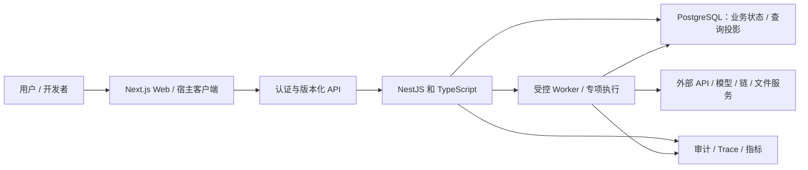

# F-U01 Multi-Tenant B2B SaaS：工程详细设计

本设计基于 [用户需求](README.md) 和 [反推基础需求](REQUIREMENTS.md)。接口、字段和目标均是建议规格；实施时锁定版本并随真实约束修订。更新：2026-10-07。

## 架构与职责

这是逻辑边界图；模块可同进程部署。Rust/合约状态按对应执行环境部署，数据库只保存合适的控制面或投影数据。审批与权限属于服务端/合约边界，不能仅依赖 UI。

主后端：**NestJS + TypeScript**。业务模块、认证 Guard、DTO 校验、REST/OpenAPI、队列与领域服务由 NestJS 管理；Next.js 承担 Web 界面，核心领域规则集中在后端。

专项组件：Prisma、PostgreSQL RLS、WorkOS、Stripe Billing。每个有持久化状态的模块指定唯一写入方；worker 对外副作用与数据库状态通过幂等、事件记录和恢复步骤协调。

## 功能设计与需求对应

| 设计 ID | 优先级 | 具体设计约束 | 基础需求 | 可观察结果 |
| --- | --- | --- | --- | --- |
| F-U01-D01 | P0 | 组织、工作区和项目分别授权，显示当前组织；切换组织清空本地资源缓存 | F-U01-BR01 | 成员切换组织后无法读取上一组织项目 |
| F-U01-D02 | P0 | 邀请绑定邮箱、组织、角色和过期时间，接受前校验身份；撤回立即失效 | F-U01-BR02 | 过期或被撤销的邀请不能加入 |
| F-U01-D03 | P0 | 项目关联任务和文件版本；客户访客仅见明确共享的交付物 | F-U01-BR03 | 访客猜测内部文件 ID 得到拒绝 |
| F-U01-D04 | P1 | SSO 和目录同步映射本地成员；离职撤销生效于后续请求 | F-U01-BR04 | 撤销后已有会话不能继续访问组织 |
| F-U01-D05 | P0 | 席位口径明确为有效成员；超限给出原因；权益变更记录来源事件 | F-U01-BR05 | 重复计费事件不会重复增加权益 |

## 领域模型与数据设计

主数据库：**PostgreSQL**。关系、事务、状态与审计适合本题，默认 Prisma。复杂约束、锁和 RLS 使用显式数据库机制；ORM 不替代业务事务。JSONB 足以承载多数半结构化 payload。

| 对象/集合/合约状态 | 关键字段 | 约束或用途 |
| --- | --- | --- |
| Organization | id,name,plan_id | 组织域名唯一性单独配置； |
| Workspace | id,organization_id,name | 组织内命名和资源边界； |
| Membership | organization_id,user_id,role,status | 组合唯一； |
| Project | id,workspace_id,owner_id,status | 不能引用其他组织成员； |
| Invitation | email,token_hash,expires_at,status | 接受操作原子执行 |

- ID、金额/数值精度、时间单位和状态枚举在 schema 中明确。JSON 大字段和二进制文件不直接混入分页响应；文件用 S3 对象引用和授权下载。
- 企业资源含必要租户/权限归属；全局配置、public chain 数据和用户隐私数据分开。合约/程序事实以链上为准，投影表带区块、版本或水位。
- 对真实唯一性的字段建立唯一约束；查询索引从接口过滤和排序出发设计。MongoDB 的唯一键、事务拓扑和关系一致性需显式验证。
- 迁移采用可回退的 expand/contract 或批量回填；先比较关键记录数、数值总量/校验和，再切流。不可变事件更正用补偿记录。

## 状态机与控制规则

**Invitation: pending → accepted / revoked / expired；Membership: active → suspended → removed；Project: draft → active → delivered → archived**。

每条转换定义触发者、前置条件、业务写入、副作用、事件和允许的恢复。使用状态/版本 compare-and-swap 或事务限制并发，不允许任意 PATCH status 跳过审批或终态检查。

- 所有业务查询必须带服务端验证的 organization_id，数据库 RLS 为防御层。
- 不能删除最后一个有效 owner。
- 审计记录 actor、资源、前后差异和 trace_id，敏感字段脱敏。

## 专项详细实现与一致性策略

1. 请求经 verified session 得到 user_id，再查询 Membership 与 workspace 归属；禁止直接信任请求中的 organization_id。RLS 会话上下文在事务内设置并结束后清除，防连接池串租户。

2. 邀请 token 仅存 hash，接受时锁 Invitation，校验 email/status/expiry；同事务写 Membership、改变 invitation 状态和 Outbox，组合唯一键 (organization_id,user_id) 限制重复接受。

3. 项目文件下载先从 Project→Workspace→Organization 校验权限，再签发短期 S3 URL；缓存 key 含 organization_id、资源版本和权限版本。

4. 席位计算排除被删除/挂起成员；owner 转让需新 owner 已有效；删除最后 owner 返回业务冲突。

## API / SDK / 合约契约

| 建议操作 | 输入与输出 | 通用契约要求 |
| --- | --- | --- |
| POST /v1/organizations | name → organization 与 owner 成员，事务提交 | 鉴权、版本校验与 request_id；按业务状态返回结果 |
| POST /v1/workspaces/{id}/invitations | email,role → invitation，权限校验 | 鉴权、版本校验与 request_id；按业务状态返回结果 |
| GET /v1/projects | workspace_id,cursor → 当前成员可见项目 | 鉴权、版本校验与 request_id；按业务状态返回结果 |
| POST /v1/invitations/{token}/accept | 已登录身份 → membership，过期返回 410 | 鉴权、版本校验与 request_id；按业务状态返回结果 |

- Web API 版本化并提供 OpenAPI/schema；MCP/合约/程序按其协议提供相应契约，避免把所有操作强制包装成 HTTP。
- 写入依据本题规则提供业务幂等键或版本；同键不同 payload 返回冲突。长任务在持久化后返回任务 ID；用户可以查询、取消或恢复。
- Web 错误建议统一结构：`code`、`message`、`request_id`、`retryable`、`details`，details 不含密钥。401 表示未认证，403 表示无权限，409 表示状态/版本冲突，429 表示限额；协议错误使用对应标准码。
- SSE/WebSocket 使用序号/事件 ID 恢复连接；流完成、取消和错误分别通知。模型、业务 job 与链上最终完成不是同一事件。

## 并发、事件与失败恢复

1. API 校验身份、资源归属和业务前置条件，再写入请求/状态。生成 request_id 与本题对象 ID。
2. 数据库业务提交和待投递事件一起持久化（在适用的状态型流程中使用 Outbox）；worker 可重复领取，副作用由唯一业务键、供应商请求 ID 或链/合约状态约束。
3. 临时网络错误退避并加抖动；鉴权、参数或业务拒绝不无限重试。次数、截止时间和预算可配置。
4. 外部结果未知时先用已有请求 ID/hash 查询；查询仍不确定则进入人工/对账状态，不把 unknown 当 failed 自动复制动作。
5. 同一事件重复、乱序、worker 崩溃和数据库提交后回包丢失各有恢复场景。取消说明已经完成和无法逆转的部分。
6. 部署重启后从持久状态恢复；数据转换的版本和原始事件足以解释结果。

## 权限、隐私与集成

权限落实到本题角色、资源和动作；操作批准绑定参数版本，敏感连接器只有 scoped credential。服务器验证 token issuer/audience、有效期和 Webhook 原始 body 签名。第三方 URLs、文件、网页文本和模型输出均经过相应边界校验。

管理员敏感操作写审计，审计查询本身也授权。Secret 存环境或 KMS，示例只给变量名。默认合成数据，真实用户接入前确定数据用途、保留期、删除和备份恢复规则。

## 运行、部署与告警

- 本地用 Docker Compose 管 DB、必要 Redis、worker 与服务替身；Web/API/worker 用非 root 容器、健康检查和 graceful shutdown。
- CI 按真实项目脚本运行类型、lint、单元/集成与关键产品路径测试；锁文件固定依赖，产物版本关联源码与迁移。
- k8s 阶段用 Helm/Terraform、readiness/liveness、资源上限、Secrets、数据库连接池与队列驱动扩容。避免同时把生产 DB 当作易失容器卷。
- Sentry/OpenTelemetry 连接 request/job/外部引用；Prometheus/Grafana 观测延迟、错误、积压与本题领域差异，严重事件按 owner 路由 PagerDuty。Web3 加链水位和 finality，AI 加模型 usage 与预算。
- 制定备份恢复演练；目标 RPO/RTO 与可用性在实际环境和用户要求下设定，当前规划不宣称线上 SLA。

## 验收场景

以下 AT 覆盖完整设计；P1 条目按上表优先级在对应阶段验收，首版不把尚未计划实现的 P1 当作已交付。

### F-U01-AT01 — 开通企业并创建客户工作区

前置：以“管理员”身份准备本题合成资源。操作：执行“开通企业并创建客户工作区”的正常与边界样例，遵循规则“组织、工作区和项目分别授权，显示当前组织；切换组织清空本地资源缓存”。断言：**成员切换组织后无法读取上一组织项目**；检查持久状态、审计与副作用，不能只断言 HTTP 200。关联：F-U01-P01 → F-U01-BR01 → F-U01-D01。

### F-U01-AT02 — 邀请员工并限制外部协作者

前置：以“管理员”身份准备本题合成资源。操作：执行“邀请员工并限制外部协作者”的正常与边界样例，遵循规则“邀请绑定邮箱、组织、角色和过期时间，接受前校验身份；撤回立即失效”。断言：**过期或被撤销的邀请不能加入**；检查持久状态、审计与副作用，不能只断言 HTTP 200。关联：F-U01-P02 → F-U01-BR02 → F-U01-D02。

### F-U01-AT03 — 分派任务并审阅交付物

前置：以“项目负责人”身份准备本题合成资源。操作：执行“分派任务并审阅交付物”的正常与边界样例，遵循规则“项目关联任务和文件版本；客户访客仅见明确共享的交付物”。断言：**访客猜测内部文件 ID 得到拒绝**；检查持久状态、审计与副作用，不能只断言 HTTP 200。关联：F-U01-P03 → F-U01-BR03 → F-U01-D03。

### F-U01-AT04 — 用公司身份登录并撤销成员

前置：以“企业 IT”身份准备本题合成资源。操作：执行“用公司身份登录并撤销成员”的正常与边界样例，遵循规则“SSO 和目录同步映射本地成员；离职撤销生效于后续请求”。断言：**撤销后已有会话不能继续访问组织**；检查持久状态、审计与副作用，不能只断言 HTTP 200。关联：F-U01-P04 → F-U01-BR04 → F-U01-D04。

### F-U01-AT05 — 核对席位与套餐权益

前置：以“财务管理员”身份准备本题合成资源。操作：执行“核对席位与套餐权益”的正常与边界样例，遵循规则“席位口径明确为有效成员；超限给出原因；权益变更记录来源事件”。断言：**重复计费事件不会重复增加权益**；检查持久状态、审计与副作用，不能只断言 HTTP 200。关联：F-U01-P05 → F-U01-BR05 → F-U01-D05。

## 专项质量与证据

对每个 AT 保存输入、预期、实际结果、环境与失败复现步骤。

测试选择按实现层：React/Vitest/Testing Library 与 Playwright 产品路径；NestJS/Jest 或 Vitest、Supertest、Testcontainers；Python/pytest/HTTPX；Go `go test -race`；Rust `cargo test`/Clippy；EVM/Foundry fuzz、Invariant、fork；Solana local validator 与恶意账户测试。仅安装本题实际使用的生态。

报告至少列明实现 commit、环境、输入、命令和结果。每个规则的通过结果必须来自可执行行为；测试未运行则明确标记。性能基线、AI 统计质量、链最终性与真实供应商/付款接入分别记录。

## 实现分期

1. **需求与 schema：**冻结 P0 场景、实体/权限、状态、契约和验收样本。
2. **核心路径：**实现领域规则与持久化，用服务替身跑完核心用户路径。
3. **产品体验：**接入界面、详情、错误、进度和恢复；验证角色与真实反馈。
4. **可靠性：**执行 AT、并发/重复/失败恢复和专项质量评测。
5. **集成与发布：**按本题授权范围接入供应商，补 runbook 和部署证据。后续：P1：SAML/SCIM、可配置角色与企业审计导出；P2：独立数据库租户和区域部署
